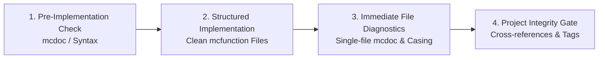

# Minecraft Datapack Engineering (Verification, Contracts & Conventions)

A comprehensive engineering standard defining the core verification lifecycle, 5-tier directory structure, validation boundaries, resource naming conventions, and IMP-Doc v2 function contracts for Minecraft Java Edition datapacks.

---

## 1. Core Engineering Workflow: The 4-Stage Lifecycle

Minecraft commands lack traditional compile-time type checking. Silent failures are the primary source of bugs. Always follow this 4-stage lifecycle, powered strictly by the companion [`datapack-mcp`](https://github.com/minkyet/datapack-mcp) plugin (MineCode & Spyglass Language Server). If `datapack-mcp` is missing, operations must halt immediately (see Section 4 and `rules/AGENTS.md`).



### Stage 1: Pre-Implementation Specification Check
- **NBT & Component Schema**: Before using `summon`, `data modify`, or item components, inspect the authoritative schema via mcdoc symbols (e.g. `spyglass_get_mcdoc_symbol("minecraft::entity::Interaction")`).
  - *Critical Trap*: Minecraft silently ignores casing errors in NBT (e.g., `{Width: 4.0f}` instead of `{width: 4.0f}`). The entity will summon with default values and report success, causing silent runtime failures.
- **Brigadier Syntax**: Verify command arguments and subcommands before writing unfamiliar syntax using Brigadier usage tools (`get_command_usage`).

### Stage 2: Clean Implementation & Tool Safety
- Implement functions adhering strictly to coding conventions, IMP-Doc v2 contracts, and scheduled loop safety idioms.
- Avoid raw shell redirections (`cat << 'EOF'`). Always use dedicated, safe file editing tools to prevent character encoding corruption and shell escaping artifacts.

### Stage 3: Immediate Single-File Diagnostics
- Immediately after creating or updating any `.mcfunction` or `.json` file, run single-file static diagnostics (`spyglass_diagnose_file`).
- Verify mcdoc field name casing, SNBT syntax, and local selector arguments before proceeding to the next file.

### Stage 4: Project-Wide Integrity Analysis
- Before finishing any multi-file task, refactoring, or feature, run whole-project static analysis (`spyglass_analyze_project`).
- Ensure all function paths (`function <namespace>:...`), function tags (`#minecraft:tick`, `#minecraft:load`), and entity tags resolve correctly with zero undefined symbols or dead references.
*(Detailed guide: [references/verification-and-mcdoc.md](references/verification-and-mcdoc.md))*

---

## 2. Fundamental Engineering & Coding Conventions

### Rule 1: Function Formatting & IMP-Doc v2 Contracts
- **Mandatory Header Format**: Every `.mcfunction` file MUST start with the standard IMP-Doc v2 header:
  ```mcfunction
  #> <namespace>:path/to/function
  # Brief explanation (one-line summary)
  #
  # @context @root (or player, entity, etc.)
  # @public / @internal / @private within <path>
  # @handles function_tag <tag> (include if triggered by function tag/advancement)
  # @reads / @writes / @input / @returns (include if applicable; explicit holders required)
  ```
- **Context and Scope Constraints**:
  - `user/` functions MUST declare `@context player` (or player-centric context).
  - `game/` functions MUST declare `@internal` (or `@private within ...`). Never `@public`.
- **Comment Hierarchy**:
  - Subsections/topic dividers in the function body use `##` without section numbers (e.g., `## Initialize variables`, never `## 1. Initialize variables`).
  - Contextual comments use `#` minimally, only for essential context. No rigid language restriction is enforced; match the project's requirements.
- **Line Wrapping & Indentation**:
  - Trailing backslash (`\`) for long commands.
  - Continuation lines must use **4 spaces** indentation. Hard tabs (`\t`) are strictly prohibited.
- **Safe Tick Loop Pattern**:
  - Check `#stop_requested_*` at the very top of scheduled loops; if set, branch to cleanup and `return run`.
  - Reschedule at the bottom via `schedule function <function_name> 1t append`.
- **Minecraft 1.21.5+ Text Component Formatting**:
  - Quoted JSON string components (e.g. `'{"text":"hello"}'`) output raw JSON literals starting in 1.21.5+.
  - Always use unquoted JSON objects (e.g. `tellraw @a {"text":"hello"}`) or raw string literals (`tellraw @a "hello"`).
*(Detailed guides: [references/code-conventions.md](references/code-conventions.md) | [references/imp-doc-v2.md](references/imp-doc-v2.md))*

### Rule 2: Datapack Entry Points & 5-Tier Directory Hierarchy
- **Lifecycle Entry Points**: In `data/<namespace>/function/` root, **ONLY** designated lifecycle entrypoints are permitted:
  - `load.mcfunction`: Registered in `#minecraft:load` (`@internal`). Boot environment initialization for scoreboard objectives and immutable constants (`##<value>`).
    - **Hot-Reload Safety Contract**: Because `load` fires on server startup, world joining, and **any mid-game `/reload`**, it MUST be strictly **non-destructive and idempotent**.
    - **Strictly Forbidden in `load`**: Resetting or mutating runtime/player scores (e.g. `set @a gold 0`, `set #state 0`, `#wave`), spawning or killing entities (`summon`, `kill`), restoring map blocks (`fill`, `setblock`), or modifying player inventories/locations (`give`, `tp`). Doing so destroys active gameplay progression on `/reload`.
    - Initializing runtime state, spawning fixed NPCs, or restoring arenas is strictly the responsibility of `reset.mcfunction` (or one-time player join handlers via tags).
  - `tick.mcfunction`: Registered in `#minecraft:tick` (`@internal`). 20Hz clock loop dispatcher.
  - `uninstall.mcfunction`: **Mandatory Teardown Hook for ALL datapacks** (`@public`). Cancels active schedules (`schedule clear`), kills entities tagged `<namespace>`, removes bossbars, storages, and objectives.
  - `reset.mcfunction`: **Mandatory Factory Reset Hook for Map-Dependent Packs** (`@public`, optional for standalone libraries). Prepares factory state before release by executing:
    1. `function <namespace>:uninstall` (Teardown)
    2. `function <namespace>:load` (Bootstrap)
    3. Map seeding logic (spawning fixed NPCs, gamemodes, spawns, resetting runtime scores `#state = 0`).
    *(Note: `reset` and `uninstall` must never be called during active gameplay or tick loops).*
- **5 Core Functional Tiers**:
  - `user/`: Controller / Gatekeeper. Player input handling (`/trigger`, interaction bridge). Strictly `@context player`. Implements the **Standard 3-Step Protocol**: (1) Consume input/reset triggers first, (2) Actor qualification & early exit, (3) Delegate to `game/` (or `visual/` for UI). Target state checks are forbidden here.
  - `game/`: Model / Domain Logic. Core game mechanics and state mutations. Strictly `@internal`. Encapsulates **Domain Invariant Guards** (target object validity, vehicle seats, shop stock, match states; safely reusable across player actions, AI agents, and events). Omits redundant actor qualification checks when called from `user/`, while enforcing state guards on async/tick calls.
  - `visual/`: View / Render. Pure presentation side-effects (particles, sounds, displays, `tellraw`). Never mutates game scores/storages.
  - `system/`: Infrastructure. Schedulers, cleanup tasks, and sensor listeners (bridges interaction clicks to `user/` via `execute on target`).
  - `system/util/`: Library. Pure, stateless utility functions (math, RNG, raycasting).
  - *(Projects retain discretion to add custom top-level tiers like `event/` or `custom/` when needed).*
- **Private Subroutine Functions (`zzz/`)**:
  - Helper functions dedicated to a specific parent function must be placed in a flat `zzz/` folder inside the parent's directory (e.g. `system/timer/zzz/tick_helper.mcfunction`) with `@private within <parent_path>`.
  - **No Subroutine Nesting**: `zzz/zzz/` chaining is forbidden.
  - **No Subroutines in `user/`**: `user/` functions must remain lean controllers without `zzz/` folders. Complex routines belong in `game/` or `system/util/`.
*(Detailed guide: [references/code-conventions.md](references/code-conventions.md))*

### Rule 3: Namespace & Resource Naming Standards
- **Datapack Name & Namespace**: Follow `snake_case` (`^[a-z0-9_.-]+$`). The namespace must match the datapack name (`<namespace>` == datapack name). Only 1 custom namespace per pack (+ `minecraft`).
- **Scoreboard Objectives**:
  - Global state: `<namespace>`
  - General dummy: `<namespace>.<role>`
  - Display (sidebar, belowname): `<namespace>.display.<role>`
  - Constants: `<namespace>.const` | Temp calculation: `<namespace>.temp`
  - Non-dummy criteria: `<namespace>.<criteria>.<role>`
- **Fake Players (Score Holders)**: Use `snake_case`:
  - General registers: `#` prefix (e.g. `#time`, `#mob_count`)
  - Constants: `##` prefix (e.g. `##20`, `##3600`)
  - Display / HUD slots: `$` prefix (e.g. `$line1`, `$line6`)
- **Other Resources**:
  - Entity tags: `<namespace>.<role>[.<subrole>]`
  - Storage: `<namespace>:<table>` | Bossbars: `<namespace>:<name>`
  - Item custom_data: `[custom_data={<namespace>:{<nbt>}}]`
*(Detailed guide: [references/code-conventions.md](references/code-conventions.md))*

---

## 3. Quick-Start Assets & Templates

Reusable boilerplate templates are located in `assets/templates/`:
- `assets/templates/pack.mcmeta`: Modern pack metadata template.
- `assets/templates/function_template.mcfunction`: IMP-Doc v2 documented function skeleton adhering to the header standard.
- `assets/templates/user_function_template.mcfunction`: Standard 3-step controller skeleton for player input.
- `assets/templates/entrypoints/`: Lifecycle entrypoint templates (`load.mcfunction`, `tick.mcfunction`, `reset.mcfunction`, `uninstall.mcfunction`).
- `assets/templates/loops/safe_tick_loop.mcfunction`: Safe scheduled loop with stop flag check.

---

## 4. Mandatory Dependency Gate: `datapack-mcp` Prerequisite

`datapack-engineering` is architecturally coupled to [`datapack-mcp`](https://github.com/minkyet/datapack-mcp). Minecraft command execution has no compile-time checking; attempting to write or refactor datapacks without Spyglass static type checking and MineCode syntax verification introduces silent runtime failures and is strictly prohibited.

- **Non-Negotiable Prerequisite**: If `spyglass_*` (`spyglass_diagnose_file`, `spyglass_analyze_project`) or `minecode_*` tools are not available in the active toolset, **this skill MUST NOT proceed**.
- **Self-Healing & Hard Stop Policy**: Detailed auto-installation commands (for Antigravity, Claude Code, and Codex) and the mandatory Hard Stop policy are defined in [rules/AGENTS.md](../../rules/AGENTS.md).
