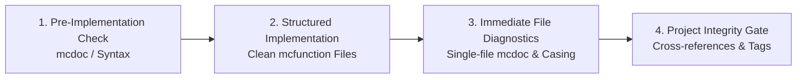

# Minecraft Map Datapack Engineering (Verification, Contracts & Conventions)

A comprehensive engineering standard defining the core verification lifecycle, 4-tier directory structure, validation boundaries, resource naming conventions, and IMP-Doc v2 function contracts for Minecraft Java Edition map-making datapacks.

---

## 1. Core Engineering Workflow: The 4-Stage Lifecycle

Minecraft commands lack traditional compile-time type checking. Silent failures are the primary source of bugs. Always follow this 4-stage lifecycle, powered strictly by the companion [`datapack-mcp`](https://github.com/minkyet/datapack-mcp) plugin (MineCode & Spyglass Language Server). If `datapack-mcp` is missing, operations must halt immediately (see Section 4 and `rules/AGENTS.md`).

### Stage 1: Pre-Implementation Specification Check
- **NBT & Component Schema**: Before using `summon`, `data modify`, or item components, inspect the authoritative schema via mcdoc symbols (e.g. `spyglass_get_mcdoc_symbol("minecraft::entity::Interaction")`).
  - *Critical Trap*: Minecraft silently ignores casing errors in NBT (e.g., `{Width: 4.0f}` instead of `{width: 4.0f}`). The entity will summon with default values and report success, causing silent runtime failures.
- **Brigadier Syntax**: Verify command arguments and subcommands before writing unfamiliar syntax using Brigadier usage tools (`get_command_usage`).

### Stage 2: Clean Implementation & Tool Safety
- Implement functions adhering strictly to coding conventions, IMP-Doc v2 contracts, and scheduled loop safety idioms.
- Avoid raw shell redirections (`cat << 'EOF'`). Always use dedicated, safe file editing tools to prevent character encoding corruption and shell escaping artifacts.

### Stage 3: Immediate Single-File Diagnostics & Convention Autofix
- Immediately after creating or updating any `.mcfunction` or `.json` file, run single-file static diagnostics (`spyglass_diagnose_file`) to verify mcdoc field name casing, SNBT syntax, and local selector arguments.
- Run `node scripts/lint-datapack.js --fix <file>` (or `npm run lint:fix`) to auto-format IMP-Doc v2 headers (`@reads` / `@writes` for scoreboards and storages, canonical directive order), normalize 4-space continuation indentation, and check convention rules.

### Stage 4: Project-Wide Integrity & Convention Analysis
- Before finishing any multi-file task, refactoring, or feature, run whole-project static analysis (`spyglass_analyze_project`) and convention linting (`npm run lint` / `node scripts/lint-datapack.js`).
- Ensure all function paths (`function <namespace>:...`), function tags (`#minecraft:tick`, `#minecraft:load`), entity tags, and convention rules pass with zero errors.
*(Detailed guide: [references/verification-and-mcdoc.md](references/verification-and-mcdoc.md))*

---

## 2. Key Engineering Invariants & Convention Quick Reference

### Rule 1: Datapack Entry Points & 4-Tier Directory Hierarchy
- **Lifecycle Entry Points**: In `data/<namespace>/function/` root, **ONLY** designated lifecycle entrypoints are permitted:
  - `load.mcfunction`: Registered in `#minecraft:load` (`@internal`). Boot initialization for objectives and constants (`##<value>`). Must be strictly non-destructive and idempotent (no score wipes, entity manipulation, or gamerule changes).
  - `tick.mcfunction`: Registered in `#minecraft:tick` (`@internal`). 20Hz clock loop dispatcher.
  - `uninstall.mcfunction`: **Mandatory Teardown Hook** (`@public`). Completely purges objectives, storages, bossbars, entities tagged `<namespace>`, and scheduled tasks (`schedule clear`) to clean up dynamic map state.
  - `reset.mcfunction`: **Mandatory Pre-distribution Factory Reset Hook** (`@public`). Restores the map to pristine initial playable state before export. Composite pipeline: 1. `function <namespace>:uninstall` → 2. `function <namespace>:load` → 3. Initial map seeding (permanent NPCs, gamemodes, spawns, initial gamerules).
  *(Note: `reset` and `uninstall` must never be called during active gameplay or tick loops).*
- **4 Core Functional Tiers**:
  - `user/`: Controller / Gatekeeper. Player input reception (`/trigger`, interaction bridge). Mandatory `@context player`. Implements the **Standard 3-Step Protocol** (1. Input reset & re-enable, 2. Qualification, 3. Delegation).
  - `game/`: Model / Domain Logic. Game mechanics and state mutations. Mandatory `@internal`. Encapsulates **Domain Invariant Guards**; omits redundant input checks when called from `user/`.
  - `visual/`: View / Render. Pure presentation side-effects (particles, sounds, displays, `tellraw`). Never mutates game scores/storages.
  - `system/`: Infrastructure. Schedulers, cleanup tasks, and sensor listeners (bridges interaction clicks to `user/` via `execute on target`).
  - *(Projects retain discretion to add custom top-level tiers like `event/` when needed).*
- **Private Subroutine Functions (`zzz/`)**:
  - Flat `zzz/` folder inside the parent's directory declaring `@private within <parent_path>`.
  - `zzz/zzz/` nesting is strictly forbidden; `user/` functions must not contain `zzz/` subroutines.
*(Detailed architectural guide & patterns: [references/code-conventions.md](references/code-conventions.md#2-datapack-entry-points-root-function-rules))*

### Rule 2: Function Formatting & IMP-Doc v2 Contracts
- **Header Standard**: Every `.mcfunction` file MUST start with the standard IMP-Doc v2 header (`#> <namespace>:path/to/function`) with explicit `@context`, scope, and score holder directives.
- **Line Wrapping & Indentation**: Trailing backslash (`\`) for long commands; continuation lines must use **4 spaces** indentation (no hard tabs).
- **Safe Tick Loop Pattern**: Check `#stop_requested_*` at top; reschedule at bottom via `schedule function <function_name> 1t append`.
*(Detailed guides: [references/imp-doc-v2.md](references/imp-doc-v2.md) | [references/code-conventions.md](references/code-conventions.md#1-function-formatting--comment-standards))*

### Rule 3: Namespace, Naming Standards & Modern Syntax
- **Namespace Identity**: Single custom namespace matching the pack name in `snake_case`.
- **Resource Naming**: Hierarchical objectives (`<namespace>.<role>`), fake players (`#<reg>`, `##<num>`, `$<slot>`), entity tags, storage, bossbars, and item `custom_data`.
- **Minecraft 1.21.5+ Text Formatting**: Always use unquoted JSON objects or raw string literals; avoid legacy quote-wrapping.
*(Comprehensive naming tables & selector performance: [references/code-conventions.md](references/code-conventions.md#5-resource-naming-conventions))*

---

## 3. Quick-Start Assets & Templates

Reusable boilerplate templates are located in `assets/templates/`:
- `assets/templates/pack.mcmeta`: Modern pack metadata template.
- `assets/templates/function_template.mcfunction`: IMP-Doc v2 documented function skeleton adhering to the header standard.
- `assets/templates/user_function_template.mcfunction`: Standard 3-step controller skeleton for player input.
- `assets/templates/entrypoints/`: Lifecycle entrypoint templates (`load.mcfunction`, `tick.mcfunction`, `reset.mcfunction`, `uninstall.mcfunction`).
- `assets/templates/loops/safe_tick_loop.mcfunction`: Safe scheduled loop with stop flag check.

---

## 4. Mandatory Dependency Gate: `datapack-mcp` Prerequisite

`datapack-engineering` is architecturally coupled to [`datapack-mcp`](https://github.com/minkyet/datapack-mcp). Minecraft command execution has no compile-time checking; attempting to write or refactor datapacks without Spyglass static type checking and MineCode syntax verification introduces silent runtime failures and is strictly prohibited.

- **Non-Negotiable Prerequisite**: If `spyglass_*` (`spyglass_diagnose_file`, `spyglass_analyze_project`) or `minecode_*` tools are not available in the active toolset, **this skill MUST NOT proceed**.
- **Self-Healing & Hard Stop Policy**: Detailed auto-installation commands (for Antigravity, Claude Code, and Codex) and the mandatory Hard Stop policy are defined in [rules/AGENTS.md](../../rules/AGENTS.md).
