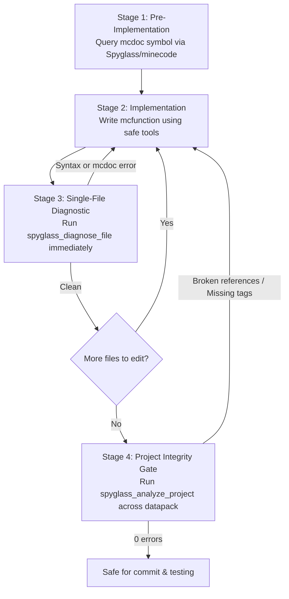

# Verification Pipeline, Static Analysis & mcdoc Schema Guardrails

Minecraft command execution features no compile step. Errors in function syntax, entity NBT, or data component schemas often result in **Silent Failures**—where the engine accepts the command, emits no error logs, but ignores invalid fields or fails to execute logic.

This document details the verification pipeline and static analysis tools required to eliminate runtime bugs.

---

## 1. The Silent Failure Trap: Brigadier vs. mcdoc

Understanding how Minecraft validates commands is critical to writing bug-free datapacks:

| Layer | Tool | What It Validates | Limitations |
|---|---|---|---|
| **Brigadier Parser** | Command line / `validate_command` | Top-level grammar, command tree, SNBT syntax | Treats `{Width: 4.0f}` as valid SNBT syntax; does **NOT** check if the entity has a `Width` field. |
| **mcdoc Type Checker** | Spyglass LSP / `spyglass_diagnose_file` | Precise field names, casing, types, component schemas | Validates statically against Minecraft's actual entity & component schemas. |
| **Runtime Entity Loader** | In-game `/data get entity` | Actual entity memory after summon | Runtime-only observation. |

### The Silent Ignore Hazard
If you summon an entity with an incorrectly cased NBT field:
```mcfunction
# BUG: Silent failure!
summon interaction ~ ~ ~ {Width:4.0f,Height:2.0f}
```
Minecraft will:
1. Parse the SNBT string without throwing a Brigadier error.
2. Summon the interaction entity successfully.
3. Silently drop `Width` and `Height` because the valid fields are lowercase `width` and `height`.
4. The hitbox remains at default (1×1), and in-game debugging becomes extremely perplexing.

---

## 2. The 4-Stage Verification Pipeline



### Stage 1: Pre-Implementation Schema Check
Before writing complex NBT tags (`summon`, `data modify`, `item_modifier`, custom components):
1. Search or retrieve the schema:
   - Tool: `spyglass_search_mcdoc_symbols` or `spyglass_get_mcdoc_symbol`
   - Example target: `minecraft::entity::Interaction`, `minecraft::entity::Display`
2. Confirm the exact case-sensitive field names and types.

### Stage 2: Implementation
- Write logic cleanly using safe file authoring tools.
- Adhere to `#state` FSM and `#` fake player standards.

### Stage 3: Immediate File Diagnostics
- Immediately after creating or editing any `.mcfunction` or `.json` file, run:
  - Tool: `spyglass_diagnose_file`
- This catches:
  - Unknown NBT keys and casing mismatches.
  - Invalid command argument combinations.
  - Invalid JSON component syntax.

### Stage 4: Project-Wide Integrity Analysis
- Before completing tasks, merging PRs, or releasing map updates, run:
  - Tool: `spyglass_analyze_project`
- This ensures:
  - Every `function <namespace>:<path>` resolves to an existing file.
  - Every tag in `tags/function/` points to valid functions.
  - No broken cross-references exist across the entire project.
