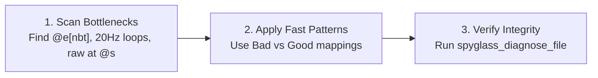

# Datapack Optimization Guide (Performance & Low Overhead)

A concise, example-driven reference and workflow for optimizing Minecraft Java Edition datapacks. Focuses on minimizing tick lag, pruning entity selector search pools, replacing heavy NBT scans, and streamlining execution contexts.

---

## 1. Quick Workflow: 3-Step Optimization Pass



1. **Audit**: Locate `#minecraft:tick` functions, unbounded `@e[...]` selectors, `nbt={...}` filters, and repetitive `execute at @s`.
2. **Transform**: Apply the short Bad/Good patterns below.
3. **Verify**: Run `spyglass_diagnose_file` on modified files and `spyglass_analyze_project` to ensure zero broken references.

---

## 2. Entity Selector Tuning (Prune Search Pools)

Minecraft evaluates selectors by filtering candidates from a candidate pool. Always narrow the pool before applying filters.

### 2.1 Chunk Limiting (`distance`, `dx/dy/dz`)
Limit candidate entities to loaded chunks near the execution origin.

```mcfunction
# BAD: Scans all entities across all ticking chunks in the world
execute as @e[type=pig] run ...

# GOOD: Restricts candidate pool to a 32-block spherical radius
execute as @e[type=pig,distance=..32] run ...

# GOOD: Restricts candidate pool to a specific bounding box
execute as @e[type=item,dx=10,dy=5,dz=10] run ...
```

### 2.2 Dimension Limiting (`x=0` Context Lock)
Adding `x=0` (or `y=0`, `z=0`) locks the selector pool strictly to the current executing dimension, skipping other dimensions entirely.

```mcfunction
# BAD: Evaluates entities in Overworld, Nether, and The End
execute as @e[type=interaction,tag=shop_npc] run ...

# GOOD: Prunes search pool to current dimension only
execute as @e[type=interaction,tag=shop_npc,x=0] run ...
```

### 2.3 Players Only (`@a` vs `@e[type=player]`)
`@a` queries the dedicated player list directly ($O(P)$), whereas `@e[type=player]` iterates through the entire entity list ($O(E)$).

```mcfunction
# BAD: Scans entire entity registry then filters by player type
execute as @e[type=player] run ...

# GOOD: Direct lookup from player list
execute as @a run ...
```

### 2.4 Entity Type Indexing (`type=`)
Minecraft maintains per-type entity buckets. Unscoped selectors force a scan of every entity in memory.

```mcfunction
# BAD: Full iteration over all armor stands, markers, items, monsters
execute as @e[tag=checkpoint] run ...

# GOOD: Prunes pool via type bucket first
execute as @e[type=marker,tag=checkpoint] run ...
```

### 2.5 UUID Direct Targeting for Unique Entities
For unique, singleton entities (e.g. world spawn anchors, master control markers), assign a fixed integer UUID at summon time and target it by UUID string. Resolves in $O(1)$ without selector overhead.

```mcfunction
# 1. Summon with fixed int-array UUID:
summon marker 0 64 0 {UUID:[I;123,0,0,1]}

# BAD: Scans entities and filters tags
execute as @e[type=marker,tag=spawn_anchor,limit=1] run ...

# GOOD: O(1) direct entity lookup by UUID hex representation
execute as 7b-0-0-0-1 run ...
```

---

## 3. Eliminating NBT Selectors (Heavy NBT Scan)

> [!WARNING]
> Selecting by `nbt={...}` serializes and deserializes the full entity NBT compound every single evaluation. It is one of the highest causes of command lag. **Never use `nbt={...}` in selectors.**

### 3.1 Item Entity Detection (`if items`)
Replace item NBT inspection with Brigadier subcommands.

```mcfunction
# BAD: Serializes full ItemStack NBT every check
execute as @e[type=item,nbt={Item:{id:"minecraft:slime_ball"}}] run ...

# GOOD: Native memory inspection without NBT serialization
execute as @e[type=item] if items entity @s contents slime_ball run ...
```

### 3.2 Entity State Inspection (`if predicate`)
Replace state/flag NBT checks with predicates (either inline or in `data/<namespace>/predicate/`).

```mcfunction
# BAD: Serializes full entity data to check on-ground status
execute as @e[type=pig,limit=1,nbt={OnGround:true}] run ...

# GOOD: Native predicate check (O(1) boolean flag lookup)
execute as @e[type=pig,limit=1] if predicate {type:"minecraft:entity_properties",entity:"this",predicate:{flags:{is_on_ground:true}}} run ...
```

### 3.3 Custom Data Flags (Tags & Scores instead of NBT)
Do not query custom entity or item data via selector NBT.

```mcfunction
# BAD: Full NBT check for custom marker data
execute as @e[type=marker,nbt={custom_data:{active:1b}}] run ...

# GOOD: Use entity tags (indexed bitset)
execute as @e[type=marker,tag=active] run ...

# GOOD: Use scoreboards (fast integer memory)
execute as @e[type=marker] if score @s active matches 1 run ...
```

---

## 4. Tick & Loop Optimization (20Hz Clock Reduction)

### 4.1 Minimizing `#minecraft:tick` Registration
Functions registered in `#minecraft:tick` execute 20 times every second for the entire game lifetime.

```mcfunction
# BAD: 20Hz polling in tick.mcfunction for an event that happens rarely
# (inside tick.mcfunction)
execute as @a[scores={used_carrot_on_a_stick=1..}] run function mypack:on_click

# GOOD: Event-driven execution via Advancement trigger
# Trigger: "minecraft:item_used_on_block" or scoreboard trigger handled on demand.
```

### 4.2 Location Polling via Advancement (1Hz / 20-Tick Throttling)
Player location triggers in advancements are throttled by the engine to run once per second (every 20 ticks), rather than 20 times per second.

```mcfunction
# BAD: 20Hz distance checks for all players in tick loop
execute as @a at @s if entity @s[x=10,y=64,z=10,distance=..3] run function mypack:enter_portal

# GOOD: Location trigger in advancement (runs at ~1Hz with zero function overhead when idle)
# See references/predicate-and-advancement-patterns.md for JSON template.
```

### 4.3 Schedule-Based Variable Ticking
If a task does not need 20Hz fidelity, run it with `schedule` at 5t, 10t, or 20t intervals.

```mcfunction
# BAD: Executing every tick and checking a timer score
scoreboard players add #timer game 1
execute if score #timer game matches 20.. run function mypack:system/regenerate_mana
execute if score #timer game matches 20.. run scoreboard players set #timer game 0

# GOOD: Dedicated self-rescheduling loop at lower frequency
#> mypack:system/regenerate_mana
# @internal
execute unless score #active game matches 1 run return fail
# ... (mana regeneration logic) ...
schedule function mypack:system/regenerate_mana 1s replace
```

### 4.4 Guard Clauses & Early Returns (`return fail` / `return run`)
Avoid executing unnecessary command lines when conditions are not met. Place guard checks at the top of functions.

```mcfunction
# BAD: Condition repeated on every single line; evaluates predicate 3 times
execute if score #game_state system matches 1 run say Step 1
execute if score #game_state system matches 1 run say Step 2
execute if score #game_state system matches 1 run say Step 3

# GOOD: Early exit guard clause; evaluates condition once
execute unless score #game_state system matches 1 run return fail
say Step 1
say Step 2
say Step 3
```

---

## 5. Execution Context Optimization

`execute at @s` synchronizes three separate properties: **Position**, **Rotation**, and **Dimension**. Only synchronize what is actually required.

### 5.1 Coordinate-Only vs Rotation-Only Synchronization

```mcfunction
# SUBOPTIMAL: Synchronizes position, rotation, AND dimension
execute as @a at @s run particle flame ~ ~1 ~ 0 0 0 0 1

# OPTIMAL: Synchronizes position only (avoids rotation calculation)
execute as @a positioned as @s run particle flame ~ ~1 ~ 0 0 0 0 1

# SUBOPTIMAL: Synchronizes position and rotation when only facing angle matters
execute at @s positioned ^ ^ ^1 run ...

# OPTIMAL: Synchronizes rotation only (keeps current position context)
execute rotated as @s positioned ^ ^ ^1 run ...
```

---

## 6. Syntax & Namespace Hygiene

### 6.1 Omitting Default `minecraft:` Namespace
The `minecraft:` default namespace is implicitly resolved by the Brigadier parser. Omitting it reduces command length and parsing token count.

```mcfunction
# VERBOSE
setblock ~ ~ ~ minecraft:stone
give @s minecraft:diamond 1
particle minecraft:flame ~ ~ ~

# CLEAN & COMPACT
setblock ~ ~ ~ stone
give @s diamond 1
particle flame ~ ~ ~
```

---

## 7. Deep References & Templates

- Advanced Predicates & Advancement JSON Patterns: [references/predicate-and-advancement-patterns.md](references/predicate-and-advancement-patterns.md)
- Core Verification Pipeline & Standards: [datapack-engineering SKILL.md](../datapack-engineering/SKILL.md)
